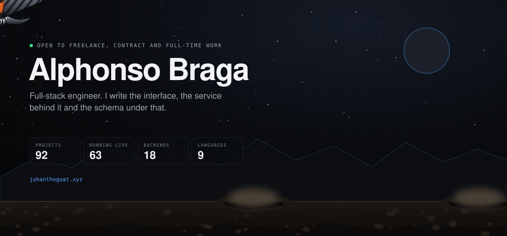
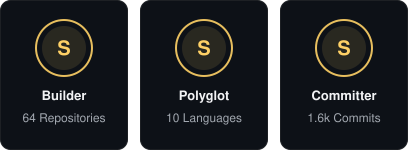

  <b>Full-stack engineer.</b> I write the interface, the service behind it and the schema under that,
   in whichever language the problem actually wants.

  
  
  
  

---

### What I build

Projects that run, not screenshots of projects. Fifty-one of them run in a browser tab and have to
hold their frame rate while they do it, driving hand and face tracking through WebGL particles or
compute shaders written in WGSL. The rest carry a real backend: schemas, migrations, HTTP APIs, a
CRDT that reconverges three offline replicas without a server deciding anything. Some are desktop
builds, some ship to Android, and one point of sale runs on a restaurant counter.

Every project states the problem, the approach and a measured result. The whole catalog builds from
one source tree into a single deployment and routes by hostname, so a case study can never link to a
stale copy of its own app.

---

### Selected work

| Project | What it is | Stack |
| :-- | :-- | :-- |
| **[Sizely](https://sizely.johanthegoat.xyz)** | Turn a US, UK or EU size into the others, or get your size from a measurement, for shoes and clothes. It leans on the measurement because fit, not price, is the top reason clothes get sent back. Tam the tape measure helps. | JavaScript, SVG |
| **[Packfit](https://packfit.johanthegoat.xyz)** | Will your bag fit? Type its size and weight, pick the airline, and get a plain yes or no with the exact amount to shave off or lift out. Measures a cabin bag side by side and a hold bag on the three sides added up. Stow the suitcase helps. | JavaScript, SVG |
| **[Readyby](https://readyby.johanthegoat.xyz)** | Tell it what you're cooking and when you want to eat, and it works out when to start each dish so the roast, the potatoes and the veg all land together, with safe pull temperatures and an oven-clash check. Ding the kitchen timer helps. | JavaScript, SVG |
| **[Divvy](https://divvy.johanthegoat.xyz)** | Split the rent when the rooms aren't equal. Everyone says what each room is worth to them and it sets envy-free rents nobody would swap, with shared bills on top. Nook the little house helps. | JavaScript, SVG |
| **[Recoup](https://recoup.johanthegoat.xyz)** | Track the last day you can take things back. It counts down every return window, sorts by what closes first, and knows the rights the law gives you on top of the shop's policy. Fetch the dog keeps watch. | JavaScript, SVG |
| **[Fridgewise](https://fridgewise.johanthegoat.xyz)** | Keep a quick list of what's in your fridge, freezer and cupboard and it sorts itself by what to eat first, using published food storage times so less gets thrown away. Frost the fridge keeps watch. | JavaScript, SVG |
| **[Wattson](https://wattson.johanthegoat.xyz)** | Add the things in your home and see what each one costs to run for a year, with the standby you forget about counted and the daily standing charge kept separate. Watt the meter helps. | JavaScript, SVG |
| **[Prorate](https://prorate.johanthegoat.xyz)** | Work out a mid-month move's rent three ways at once, see the gap between the methods, and add up the full cheque for day one. Kee the key helps. | JavaScript, SVG |
| **[GoodHours](https://johanthegoat.xyz/work/goodhours/)** | Add where everyone is and when they work, and see the meeting times inside everyone's day, with clock change warnings and fair turn-taking when nobody's day lines up. Sol the sun helps. | JavaScript, Intl API, SVG |
| **[RoomCoat](https://johanthegoat.xyz/work/roomcoat/)** | Measure a room and see how much paint it needs and the cheapest tins to buy, with doors, windows, ceilings and new plaster counted. Dab the paint tin helps. | JavaScript, SVG |
| **[Batchwise](https://johanthegoat.xyz/work/batchwise/)** | Make any recipe bigger, smaller or fit your pan. Writes amounts in the cups and spoons you own, or grams from a real weight chart, and handles part of an egg. Scoop the measuring cup helps. | JavaScript, SVG |
| **[ChoreShare](https://johanthegoat.xyz/work/choreshare/)** | A fair chore rota for a shared house or family. Splits jobs by time, not count, rotates the worst ones and writes the group chat message. Suds the soap bubble helps. | JavaScript, SVG |
| **[FocusForge](https://johanthegoat.xyz/work/focusforge/)** | A focus timer that keeps time in a hidden or reloaded tab, rings when time is up and shows where your week went, with Ember the spark mascot. | JavaScript, Web Audio, SVG |
| **[Shelf Check](https://johanthegoat.xyz/work/shelf-check/)** | Type what each shelf label says and see which pack is really cheaper, with multi-buy offers counted and the bigger-pack trap flagged. Works offline in the shop. | JavaScript, PWA |
| **[EvenUp](https://johanthegoat.xyz/work/evenup/)** | Split group costs and settle up in the fewest payments, solved exactly with a subset dynamic program. Writes the pay-me-back message for you. | JavaScript, SVG |
| **[MindMesh Board](https://johanthegoat.xyz/work/mindmesh/)** | Jot ideas, link them, and tidy them with a force-directed layout. Keyboard first, a pasted list becomes a map, and deletes stay deleted across tabs. | JavaScript, SVG, BroadcastChannel |
| **[Rate Limit Lab](https://johanthegoat.xyz/work/ratelimit-lab/)** | Five rate limiting algorithms, an HTTP middleware that speaks the IETF RateLimit headers, and a simulator that runs them side by side. | JavaScript, Node |
| **[Idempotency Lab](https://github.com/johanthegoatt/idempotency-lab)** | An Idempotency-Key middleware for node:http built to the IETF draft, and a simulator that shows what retries do to a payments API with and without it. | JavaScript, Node |
| **[Lux](https://johanthegoat.xyz/work/lux/)** | A business operating system. A business signs up, picks its type, and gets a public site, a customer record, a booking or order flow and numbers that all know about each other. | Next.js, TypeScript, PostgreSQL |
| **[Kivo](https://johanthegoat.xyz/work/kivo/)** | A life operating system: one account holding Money, School, Commute, Life and Local, with a home brief that reads all five together to say what the day asks of you. | Next.js, TypeScript, PostgreSQL |
| **[Aegis Scan](https://johanthegoat.xyz/work/aegis-scan/)** | Defensive web-security assessment. Passive scans of headers, cookies, TLS, DNS and technology hints, graded A to F with a remediation report. | Next.js, Drizzle, PostgreSQL |
| **[ONNX Digit Lab](https://johanthegoat.xyz/work/onnx-digit-lab/)** | A 26 KB neural network classifying on device. The runtime walks WebGPU, then WebGL, then WASM, and reports where it landed instead of guessing. | ONNX Runtime Web, WebGL, WASM |
| **[WebGPU Vision Lab](https://johanthegoat.xyz/work/webgpu-vision-lab/)** | Four filters written twice, once as a Canvas2D loop and once as a WGSL compute shader, on the same webcam frame. Measured 22.8x on blur, 2.1x on Sobel. | WebGPU, WGSL, WebRTC |
| **[SAT0RU](https://johanthegoat.xyz/work/sat0ru/)** | Hand-tracked technique visualiser. A classifier reads 21-point landmarks per frame and votes across a rolling window, with a geometric fallback when confidence drops. | Three.js, MediaPipe, TensorFlow.js |
| **[Local-First Sync](https://johanthegoat.xyz/work/local-first-sync/)** | A last-writer-wins CRDT with vector clocks and causal delivery, written from scratch. Property-tested across 40 randomised edit-and-gossip orders. | JavaScript, CRDT, Node |
| **[UPCAT Reviewer](https://johanthegoat.xyz/work/upcat-reviewer/)** | Adaptive study system over 1,017 questions and 28 topics that learns which topics you are weak at and schedules what to review next. | PWA, IndexedDB, Service Worker |

<a href="https://johanthegoat.xyz"><b>All 89 projects</b></a>

---

### Latest updates

<!-- updates:start -->
**24 October 2026**: one new project, five improved, and Packfit now live.

- **New: [Sizely](https://github.com/johanthegoatt/sizely)** turns a US, UK or EU size into the others, or reads your size off a measurement, for shoes and clothes. It leans on the measurement because fit, not price, is the top reason clothes get sent back. Tam the tape measure helps. [Try it](https://sizely.johanthegoat.xyz).
- **Now live: [Packfit](https://github.com/johanthegoatt/packfit)** checks a bag against an airline's cabin or hold limit and says exactly how much to shave off or lift out. Stow the suitcase helps. [Try it](https://packfit.johanthegoat.xyz).
- **[EvenUp](https://github.com/johanthegoatt/evenup)**: Cash App and Venmo handles now fill in the amount on the pay link (and Venmo picks up the trip name), the same as PayPal and Monzo already did.
- **[Snapsize](https://github.com/johanthegoatt/snapsize)**: lay the photo sheet out on A4 or US Letter and run it off on an ordinary printer, not just a 4x6 photo print.
- **[ChoreShare](https://github.com/johanthegoatt/choreshare)**: mark a chore as someone's own and it always goes to them, still counting towards their share; tick two people and they share just that one.
- **[Batchwise](https://github.com/johanthegoatt/batchwise)**: change the pan and it now guides the bake time too, since a deeper tin bakes slower and a wider one faster, with a time to start checking.
- **[RoomCoat](https://github.com/johanthegoatt/roomcoat)**: bare or new woodwork now adds a wood-primer coat before the topcoats, as its own line on the shopping list.

**22 October 2026**: one new project and six projects improved.

- **New: [Readyby](https://github.com/johanthegoatt/readyby)** gets every dish ready at the same time. It works backwards from your serving time, builds in the rest for the meat, flags when two oven dishes want different heat, and names the temperature to check the joint with. Ding the kitchen timer keeps you company. [Try it](https://readyby.johanthegoat.xyz).
- **[Recoup](https://github.com/johanthegoatt/recoup)**: extended holiday return windows, so a gift bought in November can go back into January, using the big shops' published holiday policies.
- **[Divvy](https://github.com/johanthegoatt/divvy)**: split shared bills equally on top of the rent, so each housemate sees the real monthly cheque, not just the room rent.
- **[Snapsize](https://github.com/johanthegoatt/snapsize)**: added Australia and India passport photo sizes, each with its official head-size band.
- **[Prorate](https://github.com/johanthegoatt/prorate)**: a short-let mode that prices a whole fixed-term tenancy, a part-month at each end and the full months between, three ways at once.
- **[Wattson](https://github.com/johanthegoatt/wattson)**: a "used" setting for each thing, so a space heater or air conditioner is costed for the months it actually runs, not all year.
- **[Fridgewise](https://github.com/johanthegoatt/fridgewise)**: a "use it or freeze it" nudge that works out the last day you can still freeze something to save it.

**19 October 2026**: one new project and four projects improved.

- **New: [Recoup](https://github.com/johanthegoatt/recoup)** tracks the last day you can take things back, counts down the days, and knows the return rights the law gives you on top of the shop's own policy. Fetch the dog keeps an eye on the dates. [Try it](https://recoup.johanthegoat.xyz).
- **[Wattson](https://github.com/johanthegoatt/wattson)**: add a cheaper night rate (Economy 7) and tick what you run overnight, and it charges those at the night rate and shows what moving them to the cheap hours saves over a year.
- **[Siphon](https://github.com/johanthegoatt/siphon)**: points out when two subscriptions do the same job, like two music apps or two cloud drives, and adds up what the pair costs a year.
- **[Shelf Check](https://github.com/johanthegoatt/shelf-check)**: compare concentrates fairly by typing what the bottle makes, so it ranks on the price per made-up litre, not the price per bottle.
- **[Fridgewise](https://github.com/johanthegoatt/fridgewise)**: type the date printed on a pack and say if it's a use-by or a best-before, and it gives the right advice for each, safety for a use-by and quality for a best-before.

**18 October 2026**: one new project and four projects improved.

- **New: [Fridgewise](https://github.com/johanthegoatt/fridgewise)** keeps a list of what's in your fridge, freezer and cupboard and sorts it by what to eat first, using published food storage times so less gets thrown away. Frost the fridge looks worried when something needs eating today. [Try it](https://fridgewise.johanthegoat.xyz).
- **[EvenUp](https://github.com/johanthegoatt/evenup)**: add a tip or service charge to a cost and it's shared the same way as the bill, so whoever had more pays a little more of it.
- **[Siphon](https://github.com/johanthegoatt/siphon)**: shows how much each subscription has actually cost so far, per one and as a total, because people guess their subscription spend far too low.
- **[Wattson](https://github.com/johanthegoatt/wattson)**: puts the carbon next to the cost, turning a year's electricity into kilograms of CO₂ and an easy "like driving X miles".
- **[ChoreShare](https://github.com/johanthegoatt/choreshare)**: mark a chore someone can't do at all, like a child and bleach or a bad back, and it never lands on them unless nobody else can take it.

**17 October 2026**: one new project and four projects improved.

- **New: [Wattson](https://github.com/johanthegoatt/wattson)** adds up what each thing in your home costs to run for a year, counts the standby you forget about, and keeps the daily standing charge on its own so you see what you can actually change. Watt the meter buzzes when the year lands. [Try it](https://wattson.johanthegoat.xyz).
- **[Shelf Check](https://github.com/johanthegoatt/shelf-check)**: type a loyalty or member price and it ranks on what you'd really pay with the card, and says when the card changes which pack is the best buy.
- **[Batchwise](https://github.com/johanthegoatt/batchwise)**: a new oven temperature card converts a recipe's heat between a normal oven and a fan oven, in °C, °F and gas mark.
- **[RoomCoat](https://github.com/johanthegoatt/roomcoat)**: enter the paint already in the cupboard and it comes off the shopping list, so you buy around it instead of adding to the pile.
- **[ChoreShare](https://github.com/johanthegoatt/choreshare)**: mark a whole week someone is away and they drop off the rota for it, without it counting against their fair share.

**16 October 2026**: one new project and three projects improved.

- **New: [Prorate](https://github.com/johanthegoatt/prorate)** works out part-month rent three ways at once for a mid-month move, shows the gap between the methods, and adds up the full cheque you write on day one. Kee the key jingles when the numbers land. [Try it](https://prorate.johanthegoat.xyz).
- **[Photo Fit](https://github.com/johanthegoatt/photo-fit)**: added Australia, Japan, India e-Visa/OCI and China presets, each carrying the size, head band and file limits from the issuing authority.
- **[ChoreShare](https://github.com/johanthegoatt/choreshare)**: a chore no longer lands on the same person two turns running while someone else is free, so the worst jobs actually rotate.
- **[Batchwise](https://github.com/johanthegoatt/batchwise)**: the gram chart now covers almond flour, cornmeal, cream cheese, molasses, dates, semolina and shredded coconut from King Arthur's weights.

**15 October 2026**: one new project and four projects improved.

- **New: [GoodHours](https://github.com/johanthegoatt/goodhours)** finds a meeting time that lands inside everyone's working day across time zones, warns you before clocks change, and writes the invite in each person's own time. Sol the sun turns into a sleepy moon when a time is the middle of the night for someone. [Try it](https://goodhours.johanthegoat.xyz).
- **[Velocity Lens](https://github.com/johanthegoatt/velocity-lens-java)**: plans the sprint from your own backlog CSV and packs it for the most value instead of grabbing the top scores first, with a reason for every task left out.
- **[Workflow CLI Kit](https://github.com/johanthegoatt/workflow-cli-kit)**: README checks no longer count headings inside code examples or empty sections, and runbooks are built from the project's real scripts and package manager.
- **[Hollow Purple](https://github.com/johanthegoatt/gojo-hollow-purple-web)**: hand gestures now work at any angle and any distance from the camera, and the camera says why it couldn't start.
- **[SAT0RU](https://github.com/johanthegoatt/sat0ru-main)**: keeps both hands when the tracker labels them the same side, and the backup gesture reader works with a tilted hand.
<!-- updates:end -->

---

### Tech stack

**Languages**

  
  
  
  
  
  
  
  
  
  

**Front end**

  
  
  
  
  
  
  

**Back end and data**

  
  
  
  
  
  
  

**ML and vision**

  
  
  
  
  

**Platform and tooling**

  
  
  
  
  
  
  
  

---

### The numbers

  
  

  

---

### Contributions

  

---

### Trophies

  

---

<!-- Coding time: uncomment once WakaTime has recorded a few days of hours.
     Needs "Display coding activity publicly" enabled at wakatime.com/settings/profile

### Coding time

  

-->

  
  
  

